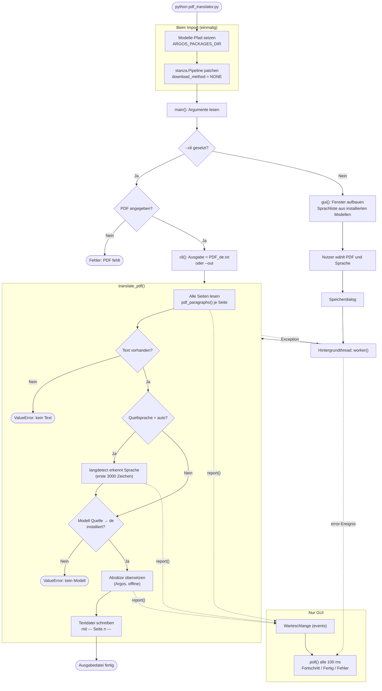

# Programmablauf

Das Diagramm zeigt die beiden Startwege (GUI und CLI) und den gemeinsamen Kern `translate_pdf()`.

## Erläuterungen

- **Stanza-Patch:** Läuft einmal beim Import, bevor Argos Stanza nutzt. Deshalb wirkt er in CLI und GUI gleich.
- **`translate_pdf()` ist der gemeinsame Kern.** CLI und GUI rufen dieselbe Funktion auf. Sie unterscheiden sich nur in der Art der Fortschrittsmeldung (`report`): Die CLI druckt, die GUI legt in die Warteschlange.
- **Die GUI arbeitet mit zwei Threads:** Die Übersetzung läuft im Hintergrund, die Oberfläche wird nur von `poll()` im Hauptthread aktualisiert. Dadurch friert das Fenster während der Übersetzung nicht ein.
